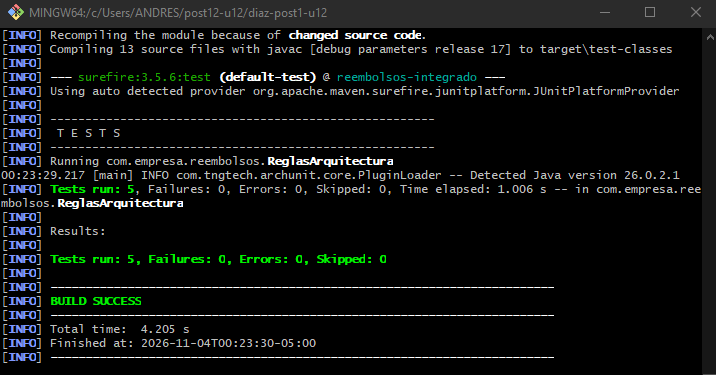
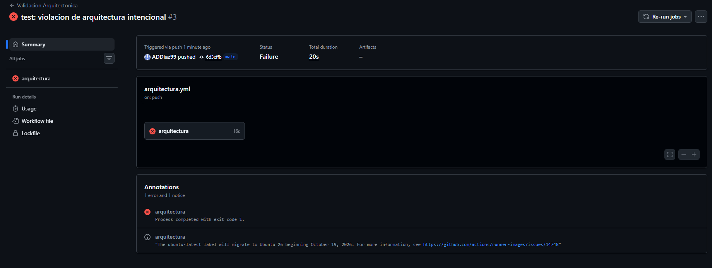
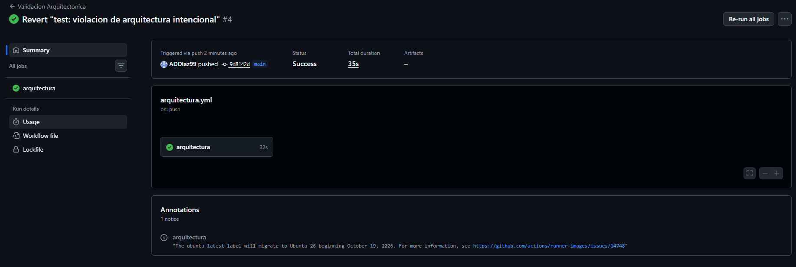
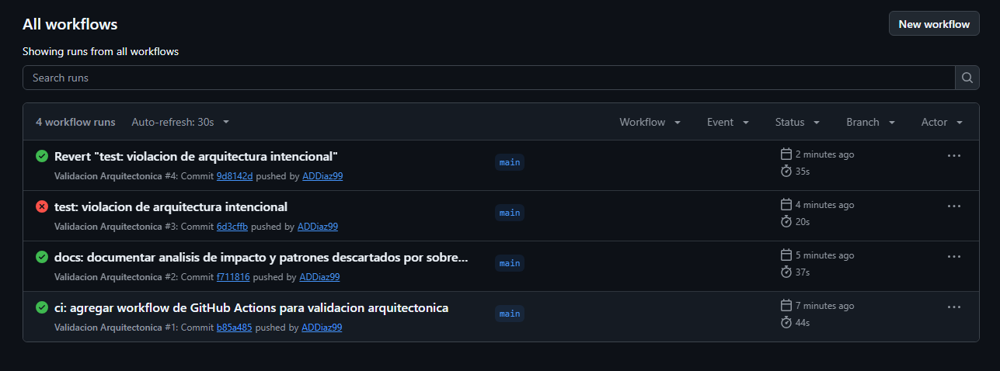
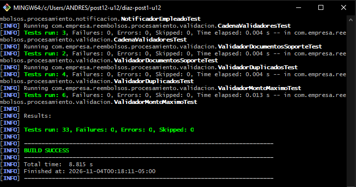

# Sistema de Solicitudes de Reembolso de Gastos Corporativos

Post-contenido 12 de Patrones de Diseño de Software (UDES): proyecto integrador.
Spring Boot 4.1.1, Java 17 o superior (probado con Java 26), Maven 3.9 y H2 en memoria.

**Contenido**

1. [Diseño Propuesto](#1-diseño-propuesto) (escrito antes de implementar los patrones)
2. [Decisiones de diseño 1 a 4](#2-decisiones-de-diseño)
3. [Resumen de ADR-001](#3-resumen-de-adr-001)
4. [Qué se descartó y por qué](#4-qué-se-descartó-y-por-qué)
5. [Arquitectura resultante y reglas ArchUnit](#5-arquitectura-resultante-y-reglas-archunit)
6. [Integración continua: violación intencional y corrección](#6-integración-continua-violación-intencional-y-corrección)
7. [Pruebas](#7-pruebas)
8. [Cómo ejecutar](#8-cómo-ejecutar)
9. [Ajustes respecto al enunciado](#9-ajustes-respecto-al-enunciado)

---

## 1. Diseño Propuesto

Antes de programar se analizó cada requisito buscando **qué cambia** y **qué va a crecer**. Un
patrón solo se propone donde hay variabilidad real y documentada en la especificación, y cada uno
debe poder justificarse en una oración (test de explicabilidad).

| Requisito | Qué varía (punto de variabilidad) | Patrón | Justificación en una oración |
|---|---|---|---|
| **RF1** Validación en varias etapas | El conjunto de verificaciones: hoy son tres y Finanzas ya anunció más (límite anual acumulado). Cada una puede detener el proceso. | **Chain of Responsibility** | Cada verificación es un eslabón que corta la cadena al fallar o la pasa al siguiente, así que una verificación nueva se agrega como eslabón sin modificar las existentes. |
| **RF2** Cálculo distinto por categoría | La fórmula del monto aprobado y el tope de cada categoría (en viáticos el tope depende de los días). Llegarán categorías nuevas, como "bienestar". | **Strategy** (con un selector que las registra por categoría) | Cada categoría trae su propia fórmula y su propio tope, así que cada una es una estrategia y una categoría nueva es una clase nueva, sin `switch` que editar. |
| **RF3** Notificación a varios interesados | Quién se entera de un cambio de estado y cómo reacciona (empleado: todo; Contabilidad: solo aprobaciones; auditoría: todo). Crecerá con el panel de métricas. | **Observer** | Varios interesados reaccionan de forma distinta al mismo evento y su número crece, así que el servicio avisa a una interfaz común y cada interesado decide qué hacer. |

**Alternativas consideradas antes de elegir**

- **RF1:** una simple lista de validadores recorrida con un `for` también funcionaría. Se prefiere la
  cadena porque el orden de las verificaciones es una decisión de diseño (Decisión 1) que queda
  escrita en un solo lugar, y porque cada eslabón decide si la solicitud continúa.
- **RF2:** un `enum` con un método abstracto por constante (como en la Unidad 11) sirve cuando el
  conjunto de casos es cerrado. Aquí no lo es: Finanzas agregará categorías, y con el `enum` cada
  categoría nueva obligaría a editar el archivo que contiene todas las fórmulas. Además metería
  reglas de negocio de Finanzas dentro del dominio.
- **RF3:** el bus de eventos de Spring (`ApplicationEventPublisher` con `@EventListener`) también
  desacoplaría, pero con tres interesados fijos y conocidos una interfaz basta y deja ver en el
  código quién reacciona a qué.

**El tope por categoría pertenece a la estrategia.** RF1 exige verificar "el tope de la categoría"
y RF2 define ese tope por categoría. Si el validador de monto guardara su propia tabla de topes,
habría dos lugares que editar por cada categoría nueva (un `switch` disfrazado de mapa) y el tope
de viáticos no podría depender de los días. Por eso cada estrategia expone `topeSolicitud(...)` y
el validador se lo pregunta.

**Cómo se componen.** `SolicitudReembolsoService` es el único punto que coordina los tres patrones
y el único que conoce el repositorio; para el controlador funciona como una fachada (Facade). No
se crean clases adicionales para eso.

**Plan de paquetes**

```
com.empresa.reembolsos
├── dominio/            SolicitudReembolso, CategoriaGasto, EstadoSolicitud (sin Spring ni JPA)
├── procesamiento/
│   ├── validacion/     RF1: Chain of Responsibility
│   ├── calculo/        RF2: Strategy + SelectorCalculadora
│   └── notificacion/   RF3: Observer
├── aplicacion/         SolicitudReembolsoService (coordina los patrones)
├── infraestructura/    RepositorioSolicitudesJpa
└── adaptadores/rest/   SolicitudReembolsoController
```

---

## 2. Decisiones de diseño

### Decisión 1: orden de la cadena de validación

**Orden elegido: documentos → monto → duplicados**, del eslabón más barato al más caro.

| Eslabón | Qué hace | Costo |
|---|---|---|
| `ValidadorDocumentosSoporte` | lee un booleano | constante |
| `ValidadorMontoMaximo` | busca la estrategia en un mapa y compara | constante |
| `ValidadorDuplicados` | recorre las solicitudes pendientes del empleado | crece con los datos |

- **Qué se gana:** las solicitudes que fallan por documentos o por monto nunca llegan a recorrer la
  lista. Y el empleado recibe primero el motivo que él mismo puede corregir (adjuntar el soporte o
  ajustar el monto) en lugar de "ya tienes una solicitud pendiente".
- **Qué se pierde:** si la mayoría de los rechazos fueran duplicados, poner ese eslabón primero los
  detectaría antes. Y hay un límite honesto: el servicio carga las pendientes **antes** de entrar
  a la cadena, así que la consulta a la base de datos se paga siempre. El orden ahorra la
  comparación en memoria, no la consulta. Ahorrar también la consulta exigiría cargarlas de forma
  perezosa, y se descartó por ahora (sección 4).

El orden queda escrito en un solo lugar, el constructor de `CadenaValidadores`, y lo verifica
`CadenaValidadoresTest.laCadenaSeCortaEnElPrimerEslabonQueFalla`: una solicitud sin documentos y
con monto excesivo se rechaza por documentos.

### Decisión 2: cómo se elige la calculadora de cada categoría

**Elegido: un mapa construido a partir de la `List<CalculadoraReembolso>` que Spring inyecta** con
todos los `@Component` registrados (`SelectorCalculadora`).

- **Con un `switch` sobre `CategoriaGasto`**, cada categoría nueva obliga a editar ese método. Si
  alguien lo olvida, el error aparece en ejecución.
- **Con el mapa**, agregar "bienestar" es crear `CalculadoraBienestar` con `@Component`: Spring la
  incluye en la lista y el selector la registra sola. No cambia ninguna línea del selector, de las
  otras calculadoras ni de los validadores. Lo único existente que se toca es la constante
  `BIENESTAR` del `enum` `CategoriaGasto`, inevitable porque la categoría es un dato del dominio.

La guía dejaba un segundo `switch` escondido: `ValidadorMontoMaximo` tenía su propio
`Map<CategoriaGasto, BigDecimal> TOPES`. Con ese mapa, una categoría nueva sin su tope provocaba un
`NullPointerException`, y el tope fijo de viáticos (150.000) rechazaba cualquier viaje de más de un
día con gastos mayores a 150.000, con lo que la multiplicación por días de `CalculadoraViaje` nunca
tenía efecto. Por eso el tope pasó a la estrategia (`topeSolicitud`).

Consecuencias: el paquete `validacion` depende de `calculo` (los dos dentro de `procesamiento`, lo
que las reglas permiten). Si dos calculadoras declaran la misma categoría, `Collectors.toMap` lanza
una excepción al arrancar, así que el error se ve de inmediato.

### Decisión 3: capas simples para la persistencia; la notificación no cambia

Se mantiene `SolicitudReembolsoService → RepositorioSolicitudesJpa` sin puerto intermedio, y el
paquete de notificación no se modifica porque `ObservadorCambioEstado` ya es el punto de extensión
para la integración que anunció Contabilidad. El razonamiento completo está en la sección 3 y en
[docs/adr/ADR-001.md](docs/adr/ADR-001.md).

### Decisión 4: la Regla 1 permite estereotipos de Spring, pero no acceso a datos ni web

La Regla 1 prohíbe que `procesamiento` dependa de `org.springframework.data`,
`jakarta.persistence`, `org.springframework.web` y `org.springframework.http`, pero **no** de
todo `org.springframework`:

- **`@Component` es metadato.** Solo lo lee el contenedor para crear el objeto; no participa en la
  lógica. Las 27 pruebas unitarias crean validadores, calculadoras y notificadores con `new`, sin
  levantar Spring, y funcionan igual. Quitar Spring sería borrar una anotación por clase.
- **Un repositorio JPA o una clase web sí es comportamiento.** Si un validador recibiera
  `RepositorioSolicitudesJpa` o un `HttpServletRequest`, su lógica dependería de una base de datos o
  de una petición HTTP y ya no se podría probar con `new`. Ese acoplamiento es el que la regla debe
  impedir.
- **Prohibir todo `org.springframework`** obligaría a registrar cada validador, calculadora y
  notificador a mano en una clase `@Configuration` con métodos `@Bean`: más código y otro lugar que
  editar por cada categoría nueva, sin un beneficio real en este proyecto (YAGNI).

La guía nombra la regla `procesamientoSinPersistenciaNiWeb` pero no incluía los paquetes web; se
agregaron `org.springframework.web..` y `org.springframework.http..` para que la regla diga lo que
promete su nombre.

---

## 3. Resumen de ADR-001

Documento completo: [docs/adr/ADR-001.md](docs/adr/ADR-001.md). Estado: **Aceptado**.

La Guía dice que la arquitectura Hexagonal vale la pena en sistemas que vivirán 3 años o más **con
cambios de infraestructura**. Se evaluó por separado cada dependencia externa:

| Dependencia | ¿Hay un cambio de infraestructura real y conocido? | Decisión |
|---|---|---|
| Persistencia | No. No existe ningún plan de cambiar de motor de base de datos. El servicio usa un solo método derivado (`findByEmpleadoIdAndEstado`) más `save` y `findById`. | **Capas simples.** Sin puerto `RepositorioSolicitudes` ni adaptador. |
| Notificación | Sí: Contabilidad integrará una API externa el próximo trimestre. | **Sin cambios.** `ObservadorCambioEstado` ya es el seam: `NotificadorContabilidad` puede llamar a la API sin tocar el servicio ni los demás observadores. |

Un dato del propio proyecto pesa a favor de no introducir el puerto: el dominio ya no depende de
JPA, porque su mapeo está en `META-INF/orm.xml`. La parte más valiosa de Hexagonal en este sistema
(un dominio que se prueba sin infraestructura) se obtiene sin el puerto.

**Positivo:** no hay interfaces ni mappers especulativos, y el único cambio con fecha ya tiene su
punto de extensión. **Negativo:** si algún día se cambia de base de datos, el puerto se introducirá
después (deuda aceptada de forma consciente), y alguien que espere simetría total puede ver la
asimetría como una inconsistencia si no lee el ADR.

---

## 4. Qué se descartó y por qué

Criterio de la Guía: ¿la variabilidad que justificaría la alternativa es **real y documentada hoy**,
o es especulación sobre un futuro que no ha llegado? Ninguno de estos descartes es definitivo: cada
uno dice qué señal haría reconsiderarlo.

### Ejemplos de referencia de la guía

**`ApplicationEventPublisher` en lugar de inyectar `List<ObservadorCambioEstado>`.** Con tres
observadores fijos y conocidos al compilar, un bus de eventos genérico no agrega desacoplamiento (ya
lo da la interfaz) y sí hace más difícil rastrear quién reacciona a qué.
*Señal para reconsiderar:* que los interesados vivan en módulos que no deban conocerse, o que se
necesite notificar de forma asíncrona.

**Visitor o Abstract Factory para exportar reportes en varios formatos.** Hoy solo existe el
requisito de CSV; no hay una segunda petición real de otro formato, así que no se cumple la Rule of
Three. *Señal para reconsiderar:* una solicitud concreta de un segundo y un tercer formato.

### Descartes propios surgidos durante la implementación

**1. Cargar las solicitudes pendientes de forma perezosa (`Supplier<List<...>>`).**
- *Qué se consideró:* pasar a la cadena un `Supplier` en lugar de la lista, para que la consulta a
  la base de datos solo ocurra si la solicitud llega al último eslabón. Salió directamente de la
  Decisión 1, al notar que el orden de la cadena no evita la consulta.
- *Por qué se descartó:* es una sola consulta por creación, filtrada por empleado y estado, sobre
  unas pocas filas. A cambio, cambiaría la firma de `validar` y `validarPropio` de **todos** los
  eslabones para optimizar solo uno. Es una optimización sin una medición que la pida.
- *Señal para reconsiderar:* la verificación de "límite anual acumulado" que Finanzas anunció. Esa
  sí necesitaría leer el historial de un año por empleado; si esa consulta resulta costosa, la carga
  perezosa pasa a estar justificada.

**2. Encadenar los validadores automáticamente con `List<ValidadorSolicitud>` y `@Order`.**
- *Qué se consideró:* que Spring inyecte todos los validadores y que `CadenaValidadores` los enlace
  en un ciclo, ordenados con `@Order`, para no tener que editar el constructor al agregar uno.
- *Por qué se descartó:* con tres eslabones, el orden es una decisión de diseño (Decisión 1) que hoy
  se lee completa en una línea. Con `@Order` quedaría repartido en números mágicos dentro de cada
  clase, y nada impediría que dos validadores tuvieran el mismo número. Se ganaría ahorrar una línea
  y se perdería legibilidad.
- *Señal para reconsiderar:* cuando lleguen las verificaciones nuevas y la cadena pase de cinco o
  seis eslabones, o si otros equipos empiezan a aportar validadores desde sus propios módulos.

**3. DTOs y un mapper para la API REST en lugar de recibir y devolver `SolicitudReembolso`.**
- *Qué se consideró:* un `CrearSolicitudRequest` y un `SolicitudResponse`, para que el cliente no
  pueda enviar campos que no le corresponden (`id`, `estado`, `montoAprobado`).
- *Por qué se descartó:* el servicio ya ignora esos tres campos al crear (pone `id` en `null`,
  calcula el monto y fija el estado), así que hoy no hay ningún dato que un DTO protegería. Serían
  tres clases nuevas por endpoint sin un problema real que resolver.
- *Señal para reconsiderar:* que la API deba diferir del dominio (versiones de la API, campos
  internos que no deben salir) o que aparezca un campo que el servicio no pueda sobrescribir.

---

## 5. Arquitectura resultante y reglas ArchUnit

Dependencias entre paquetes del código final (obtenidas con `jdeps`):

```
adaptadores.rest            ──► aplicacion, dominio
aplicacion                  ──► procesamiento.validacion, procesamiento.calculo,
                                procesamiento.notificacion, infraestructura, dominio
procesamiento.validacion    ──► procesamiento.calculo, dominio
procesamiento.calculo       ──► dominio
procesamiento.notificacion  ──► dominio
infraestructura             ──► dominio (y Spring Data JPA)
dominio                     ──► nada fuera de java.*
```

Todas las flechas apuntan hacia el dominio y ninguna sale de él. `procesamiento` no conoce ni la
base de datos ni la web. `infraestructura` es el único paquete que usa Spring Data, y el dominio se
mapea a la tabla `solicitud_reembolso` desde `src/main/resources/META-INF/orm.xml`.

Reglas en `src/test/java/com/empresa/reembolsos/ReglasArquitectura.java` (solo analizan el código de
producción, con `ImportOption.DoNotIncludeTests`):

| # | Regla | Qué protege |
|---|---|---|
| 1 | `procesamientoSinPersistenciaNiWeb` | Los patrones no dependen de `infraestructura`, `adaptadores`, Spring Data, JPA ni la web. |
| 2 | `controladorSoloUsaServicio` | El controlador solo accede al servicio, al dominio y a clases web; no puede saltarse el servicio. |
| 3 | `calculadorasImplementanInterfaz` | Toda clase `Calculadora*` implementa `CalculadoraReembolso`, o el selector no la encontraría. |
| 4 | `notificadoresImplementanInterfaz` | Todo notificador implementa `ObservadorCambioEstado`, o el servicio no le avisaría. |
| 5 | `dominioSinFrameworks` (adicional) | El dominio no depende de Spring ni de Jakarta: el checkpoint del Paso 1 queda como prueba automática. |



---

## 6. Integración continua: violación intencional y corrección

El workflow `.github/workflows/arquitectura.yml` corre en cada push y pull request a `main`:
primero las reglas de arquitectura y luego la suite completa con `mvn verify`.

Para comprobar que el pipeline detecta una violación, se agregó a `ValidadorDuplicados` un campo de
tipo `RepositorioSolicitudesJpa` (viola la Regla 1) y se subió. Se usó un campo y no solo un
`import`, porque un `import` que no se usa desaparece al compilar y ArchUnit, que analiza el
bytecode, no lo vería. Luego se revirtió con `git revert`.

**Build fallido por la violación intencional:**



**Build en verde después del revert:**



**Historial de ejecuciones (rojo y luego verde):**



---

## 7. Pruebas

| Clase de prueba | Tipo | Pruebas |
|---|---|---|
| `CalculadoraViajeTest`, `CalculadoraRepresentacionTest`, `CalculadoraCapacitacionTest` | Unitaria | 3 + 2 + 2 |
| `SelectorCalculadoraTest` | Unitaria | 2 |
| `ValidadorDocumentosSoporteTest`, `ValidadorMontoMaximoTest`, `ValidadorDuplicadosTest` | Unitaria | 2 + 6 + 4 |
| `CadenaValidadoresTest` | Unitaria | 3 |
| `NotificadorContabilidadTest`, `NotificadorEmpleadoTest` | Unitaria | 2 + 1 |
| `FlujoSolicitudReembolsoIntegracionTest` | Integración `@SpringBootTest` (HTTP + JPA + H2) | 6 |
| `ReglasArquitectura` | ArchUnit | 5 |
| **Total** | | **38** |

La prueba de integración recorre el flujo completo por HTTP: crea solicitudes de las tres
categorías y comprueba su monto aprobado, rechaza una sin documentos y un duplicado con un mensaje
claro (400), devuelve 404 para una solicitud inexistente, y verifica en la salida de consola que al
aprobar se enteran los tres interesados y que al rechazar Contabilidad no reacciona.



---

## 8. Cómo ejecutar

```
mvn clean verify                               # 38 pruebas
mvn test -Dtest=ReglasArquitectura             # solo las 5 reglas
mvn spring-boot:run                            # API en http://localhost:8080
```

Crear una solicitud de viáticos de 3 días (en Git Bash):

```
curl -X POST http://localhost:8080/api/solicitudes -H "Content-Type: application/json" -d '{"empleadoId":"emp-001","categoria":"VIAJE","montoSolicitado":400000,"fechaGasto":"2026-10-05","diasViaje":3,"documentosSoporte":true}'
```

Aprobarla (el cuerpo es el estado entre comillas, como texto JSON):

```
curl -X PUT http://localhost:8080/api/solicitudes/1/estado -H "Content-Type: application/json" -d '"APROBADA"'
```

---

## 9. Ajustes respecto al enunciado

| En la guía | Problema | Qué se hizo |
|---|---|---|
| El dominio no importa JPA, pero `RepositorioSolicitudesJpa extends JpaRepository<SolicitudReembolso, Long>` | Sin `@Entity`, Spring Data no arranca ("Not a managed type") | Mapeo en `META-INF/orm.xml`: el dominio sigue limpio y el repositorio funciona |
| Tope de viáticos fijo en 150.000 en `ValidadorMontoMaximo` | Todo viaje con gastos mayores a 150.000 se rechazaba sin importar los días | El tope vive en cada estrategia (`topeSolicitud`) |
| Mapa `TOPES` propio del validador | Una categoría nueva sin tope causaba `NullPointerException` | Igual que el anterior: un solo lugar por categoría |
| `ValidadorDuplicados` comparaba solo `getMonth()` | Octubre de 2025 chocaba con octubre de 2026 | Se compara el periodo con `YearMonth` |
| `SolicitudInvalidaException` sin manejo | El rechazo llegaba como error 500 | `@ExceptionHandler` con `ProblemDetail`: 400 si es inválida, 404 si no existe |
| Regla 2 sin el paquete del propio controlador | Leer su campo `servicio` ya es un acceso: la regla fallaba | Se incluye `..adaptadores.rest..` |
| Regla 3 sobre todo el paquete `calculo` | `SelectorCalculadora` no es una calculadora: la regla fallaba | Se filtra por nombre `Calculadora*` |
| `@AnalyzeClasses` sin opciones | Las pruebas viven en los mismos paquetes y rompen las reglas 3 y 4 | `ImportOption.DoNotIncludeTests` |
| Clase `ReglasArquitectura` | Su nombre no termina en `Test`: `mvn test` y `mvn verify` no la ejecutaban | Surefire la incluye explícitamente en el `pom.xml` |
| Violación con un `import` sin usar | El `import` no queda en el bytecode: el pipeline no fallaba | Se usa un campo del tipo prohibido |
| `archunit-junit5` 1.2.1 | Spring Boot 4 trae JUnit 6, y esa versión no lee clases de Java 26 | `archunit-junit6` 1.5.1 |
| `actions/checkout@v4`, `setup-java@v4`, `actions/cache@v3` | Versiones anteriores | `@v5` y la caché de Maven de `setup-java` |
| `crear` guardaba el `id` enviado por el cliente | Un POST con `id` podía sobrescribir otra solicitud | El servicio pone `id` en `null` antes de guardar |
| `cambiarEstado` al mismo estado | Notificaba un "cambio" que no ocurrió | Si el estado no cambia, no se notifica |
